<p align="center">
  
</p>

<p align="center">
  <a href="https://check5004.github.io/dtx-mania-web-editor/"></a>
</p>

<p align="center">
  <b>インストールも登録もいりません。</b>曲のデータはあなたの端末の中だけで扱い、どこにもアップロードしません。<br>
  PC（Chrome・Edge がおすすめ）・iPad・iPhone で使えます。画面は日本語と English。
</p>

<p align="center">
  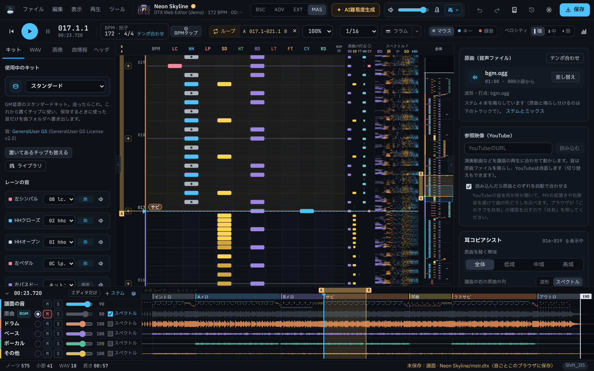
  <br>
  <sub>デモ曲「Neon Skyline」のサビを A–B ループで聴いているところ（この README のために作ったオリジナル曲です）</sub>
</p>

## できること

<table>
<tr>
<td width="33%" valign="top">
<b>🎧 耳コピを助ける</b><br>
ループ・スロー・帯域をしぼって聴けます。ブラウザの中の採譜 AI が、原曲のドラムの打点を譜面の横に並べます。
</td>
<td width="33%" valign="top">
<b>⌨️ 先回りして書く</b><br>
TAB補完が、書いた小節から続きを予想します。✨ を押せば 1 小節まるごとの案も。
</td>
<td width="33%" valign="top">
<b>🎚️ 楽器ごとに分ける</b><br>
原曲をドラム・ベース・ボーカル・その他に分けて、ドラムだけを聴いたり、ドラム抜きを BGM にしたり。
</td>
</tr>
<tr>
<td valign="top">
<b>🥁 NX と同じ 10 レーン</b><br>
左右のシンバル・ハイハット・ライドの 4 シンバルと左ペダルまで。ドラムキットは 28 種類。
</td>
<td valign="top">
<b>🤖 AI で難易度を作る</b><br>
MASTER から EXTREME・ADVANCED・BASIC をまとめて作り、並べて聴き比べて直せます。
</td>
<td valign="top">
<b>💾 NX でそのまま遊べる</b><br>
DTX（Shift_JIS）と set.def・使った音を曲フォルダへ。DTXManiaNX にそのまま置けます。
</td>
</tr>
</table>

## はじめかた

<p align="center"></p>

1. **[ブラウザで開く](https://check5004.github.io/dtx-mania-web-editor/)**　初めて開いたときは英語の画面です。ホームの右上の「日本語」で切り替えます（メニューの「表示」や設定の「言語」からも）。
2. **曲を入れる**　原曲の音声ファイル（WAV・OGG・MP3。MP4 などの動画なら音を取り出します）をホームにドロップすると、その曲を BGM にした新しい譜面ができます。今ある曲は「曲フォルダを開く」で、DTX と音をまとめて読み込みます。
3. **書いて保存**　<kbd>Ctrl</kbd>+<kbd>S</kbd> で曲フォルダに保存します。DTXManiaNX の曲のフォルダ（DTXFiles など）に置けば、そのまま遊べます。

<details>
<summary><b>ホームの画面</b></summary>
<p align="center">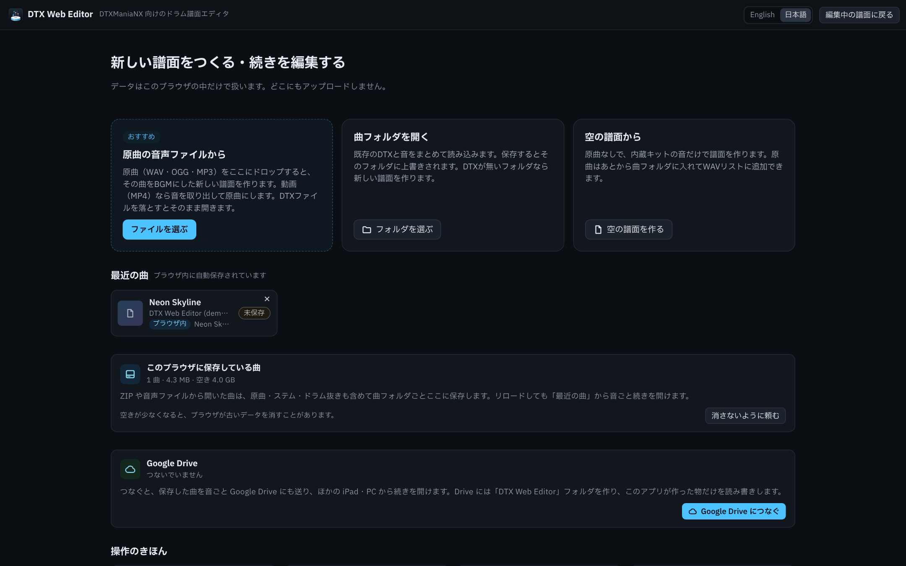</p>
</details>

<details>
<summary><b>操作のきほん（PC）</b></summary>

| したいこと | 操作 |
| --- | --- |
| 置く・消す | レーンをクリックで置く、ダブルクリックで消す。<kbd>Shift</kbd> を押しながらで HH オープン・左バスドラム |
| キーで置く | <kbd>A</kbd> <kbd>S</kbd> <kbd>Z</kbd> <kbd>D</kbd> <kbd>G</kbd> <kbd>F</kbd> <kbd>H</kbd> <kbd>J</kbd> <kbd>K</kbd> <kbd>L</kbd> が LC HH LP SD HT BD LT FT CY RD（カーソルの位置に置く） |
| 右クリック | チップの上なら強さ・HH の開閉・レーン・削除。何もない所ならグリッドの切り替え |
| 選ぶ・動かす | 空いた所をドラッグで範囲選択。チップはドラッグか矢印キーで動かす。<kbd>Ctrl</kbd>+<kbd>C</kbd> / <kbd>V</kbd> でコピー |
| 聴く | <kbd>Space</kbd> で再生と停止（止めると青い ▶ に戻る）。<kbd>Shift</kbd>+<kbd>Space</kbd> はその場で止める |
| くり返し聴く | 上のバーの「ループ」（<kbd>/</kbd>）で ▶ の小節を。A・B（<kbd>I</kbd>・<kbd>O</kbd>）で好きな範囲を |
| 元に戻す | <kbd>Ctrl</kbd>+<kbd>Z</kbd>（何回でも。時計のボタンで履歴から好きな所へ） |
| 保存 | <kbd>Ctrl</kbd>+<kbd>S</kbd> |

</details>

## 耳コピする

<p align="center"></p>

- **ゆっくり、くり返し**　A–B ループ、スロー再生（25・50・75%。音の高さは変わりません）、低域（キック）・中域（スネア・タム）・高域（ハイハット・シンバル）だけを聴く。レーンごとのミュート・ソロも。
- **原曲の打点**　ブラウザの中で動く採譜モデルが、原曲からバスドラム・スネア・タム・ハイハット・シンバルの打点を聞き取り、譜面の右に並べます。音はブラウザの外に出しません。
- **波形とスペクトル**　譜面と同じ時間の物差しで、原曲の波形かスペクトルを並べます。
- **ずれを見張る**　置いたチップと原曲の打点がずれていると知らせ、開始位置のずれか BPM の違いかを教えます。
- **テンポ合わせ**　BPM の推定、タップでの計測、1 小節目の頭の位置合わせ。途中でテンポが変わる曲も、小節線をドラッグして合わせられます。
- **YouTube の映像を並べる**　演奏動画を譜面の再生に合わせて動かせます（Chrome・Edge なら原曲とのずれも自動で合わせます）。

<details>
<summary><b>テンポと開始位置の画面</b></summary>
<p align="center">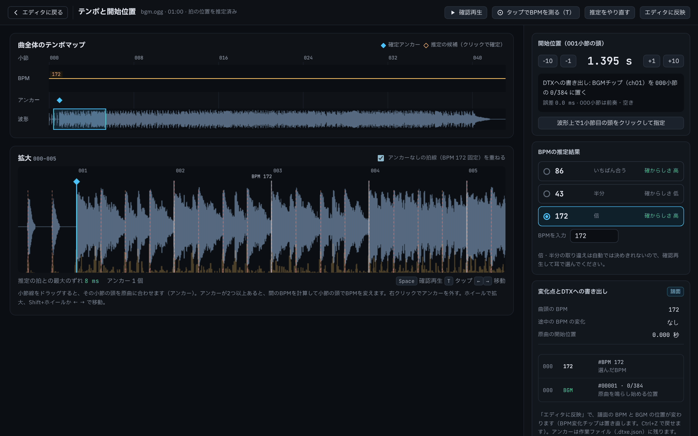</p>
</details>

## 書く

### TAB補完

<p align="center"></p>

チップを置くと、その先の空いた小節に続きを点線で出します。コードエディタの補完と同じで、<kbd>Tab</kbd> でまとめて入れ、<kbd>Shift</kbd>+<kbd>Tab</kbd> で 1 小節だけ、<kbd>Esc</kbd> で消します。続きは、この曲でもう書いた小節から写して作ります（直前と同じ並びの所や、原曲で同じに聞こえる所。1 番のサビ → 2 番のサビ など）。原曲で聞こえない所はオレンジの枠で「要確認」と知らせます。

<p align="center">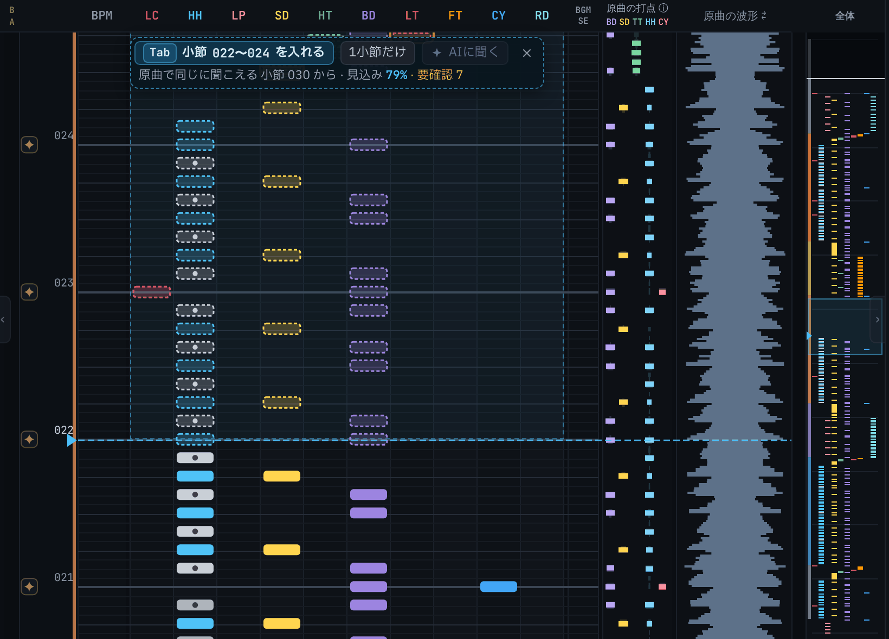</p>

### ✨ 小節の生成

小節線の ✨ を押すと、その小節の案を出します。「写す」（この曲の似た小節）、「採譜」（原曲の打点から）、「AI」（キーが要ります）の 3 種類を <kbd>Tab</kbd> で切り替え、<kbd>Enter</kbd> で入れます。案を入れたまま再生して、音で確かめられます。

<p align="center">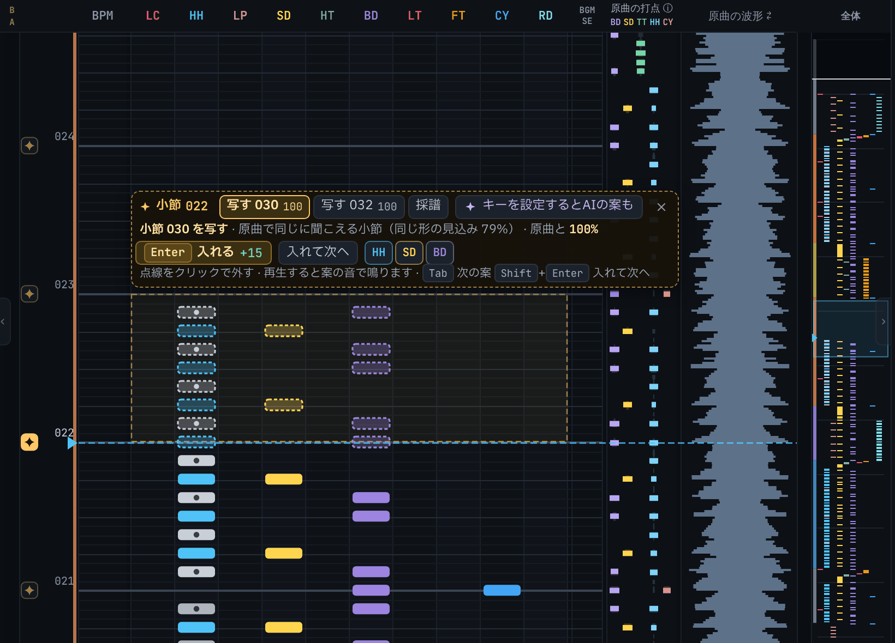</p>

### 10 レーン・4 シンバル

<p align="center"></p>

NX と同じ 10 レーン（LC HH LP SD HT BD LT FT CY RD）。HH オープン、左バスドラム、スネアのリム（クロススティック）も書けます。レーンの並びは NX の表示に合わせて入れ替えられます。

### 強さ・フラム・電子ドラム

- **強さ（ベロシティ）**　DTX には 1 打ごとの強さが無いので、音量違いの音（WAV）を自動で作って使い分けます。<kbd>V</kbd> で強さの編集。鉛筆や直線（クレッシェンド）でまとめて変えられます。
- **フラム**　装飾音をつけたチップを、1 打として扱えます。
- **電子ドラム・キーボードで録る**　再生しながら叩くと、グリッドに合わせて置きます。ループ中は周回ごとに重ねて録れます（電子ドラムは Web MIDI。PC の Chrome・Edge）。

<details>
<summary><b>強さの編集の画面</b></summary>
<p align="center">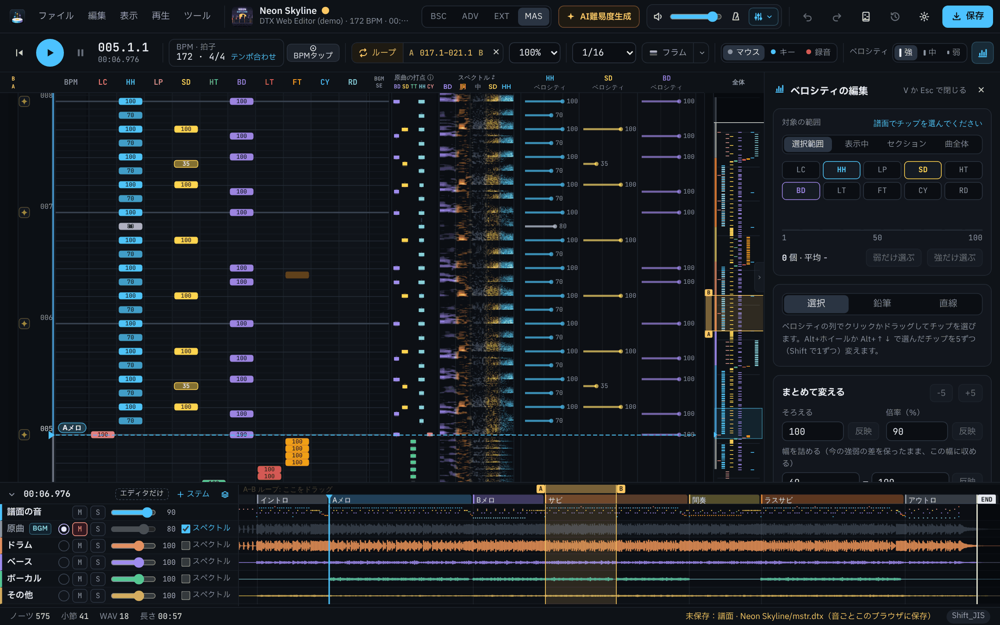</p>
</details>

## 音を整える

### ステム分解

<p align="center"></p>

原曲をブラウザの中で、ドラム・ベース・ボーカル・その他（モデルによってはギター・ピアノも）に分けます。GPU（WebGPU。Chrome・Edge）で動き、GPU が無くても軽いモデルなら動きます。分けた音はトラックごとにミュート・ソロ・音量を変えられ、ドラム抜きの音はそのまま BGM にできます。ステム分離ソフトで分けたファイルを入れることもできます。

<p align="center">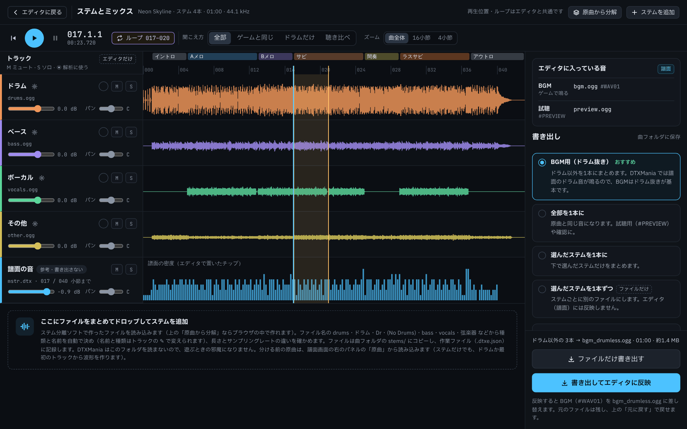</p>

### ドラムキットと音源ライブラリ

- **28 種類の標準キット**　スタンダード・ロック・メタル・ジャズ・ファンク・エレクトロ・8 ビット・FM 音源など。GeneralUser GS と CC0 の音なので、作った譜面に入れて配れます。保存するときは、使った音だけを曲フォルダに書き出します。
- **音源ライブラリ**　手元の DTX の曲フォルダから音を取り込んで、自分のライブラリにできます。楽器の自動判定、似た音さがし、曲の音を集めた「曲名キット」も。
- **特殊ノーツと音の切り出し**　クラップなどの音を種類ごとに分けて書けます。ステムや原曲から音を切り出して、レーンの音にもできます。

<details>
<summary><b>音源ライブラリの画面</b></summary>
<p align="center">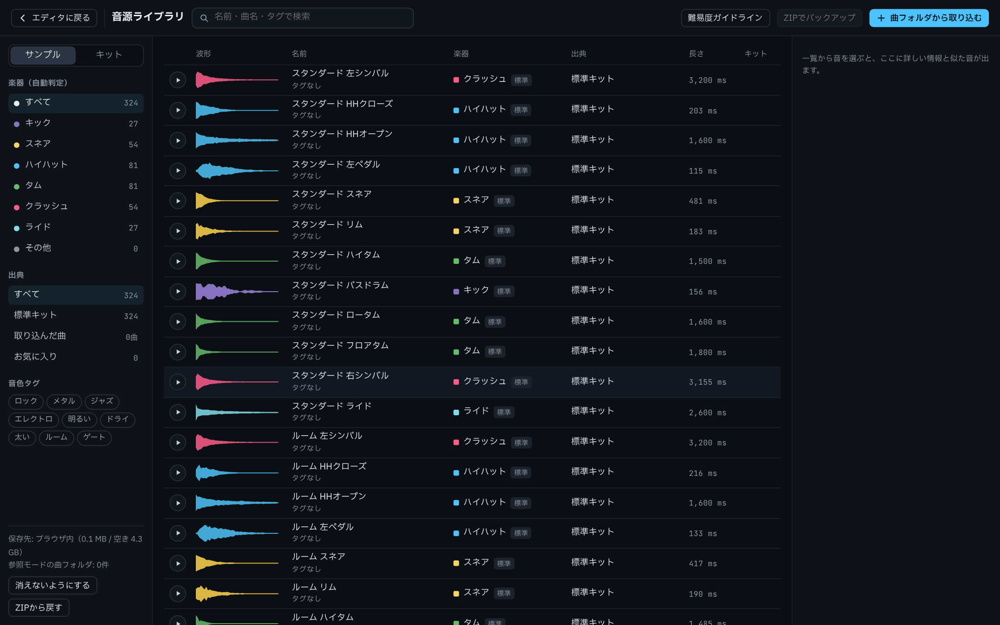</p>
</details>

### チップのエフェクト

ハイカット・ローカット・ピッチのカーブを曲に引くと、かかる所のチップの音を作って差し替えます（B メロはこもらせて、サビで開く、など）。保存すると加工した音も曲フォルダに書き出すので、NX でも同じ音で鳴ります。

<p align="center">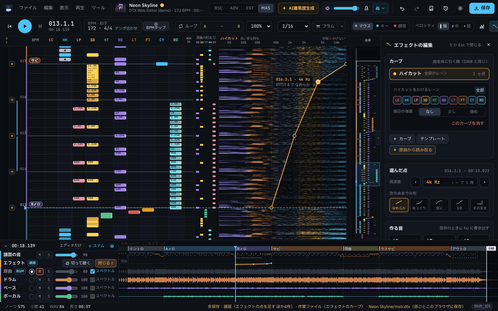</p>

## 確かめる

- **NX 風のプレビュー**　<kbd>P</kbd> で右のパネルに、<kbd>Shift</kbd>+<kbd>P</kbd> で全画面に。再生に合わせてチップが判定ラインへ落ちてきます。
- **無理な配置の警告**　手が 3 本いる同時打ち、足りない足、ハイハットの開閉の同時、速すぎる連打を知らせます。
- **レベルの目安**　打数・密度・同時打ち・手の動きから、機械的にレベルの目安を出します（AI の判定も）。

<p align="center">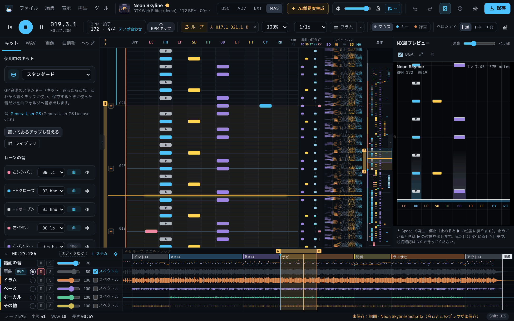</p>

## AI で作る

<p align="center"></p>

- **AI難易度生成**　開いている譜面を MASTER にして、EXTREME・ADVANCED・BASIC をまとめて作ります。AI は「どこをどう簡略化するか」とレベルの判定を受け持ち、チップはルールで置きます。並べて聴き比べ、手で直してからエディタに反映できます。キーが無くても、ルールだけで作れます。
- **曲情報を調べる**　原曲のファイル名やタグから、曲名・アーティスト・BPM・ジャケットなどを調べて埋めます。
- **フレーズ候補・小節の AI 案・レベル判定**　フィルやリズムの候補、手元の似た譜面を物差しにしたレベルの判定も。

AI は [OpenRouter](https://openrouter.ai/) を使います。キーは「設定 › AI」で入れ、このブラウザにだけ保存します。AI に送るのは譜面の特徴やチップの並び、打点の数値などで、音そのものは送りません。

<p align="center">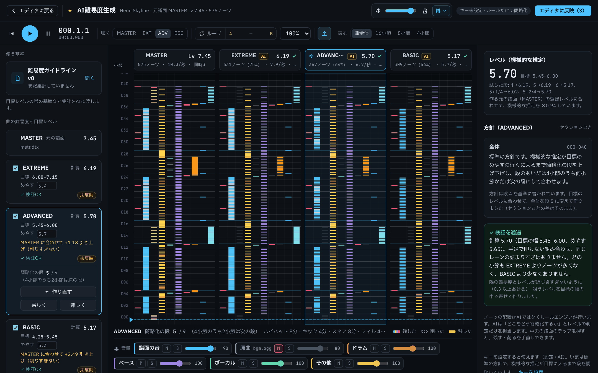</p>

<details>
<summary><b>曲情報の画面</b></summary>
<p align="center">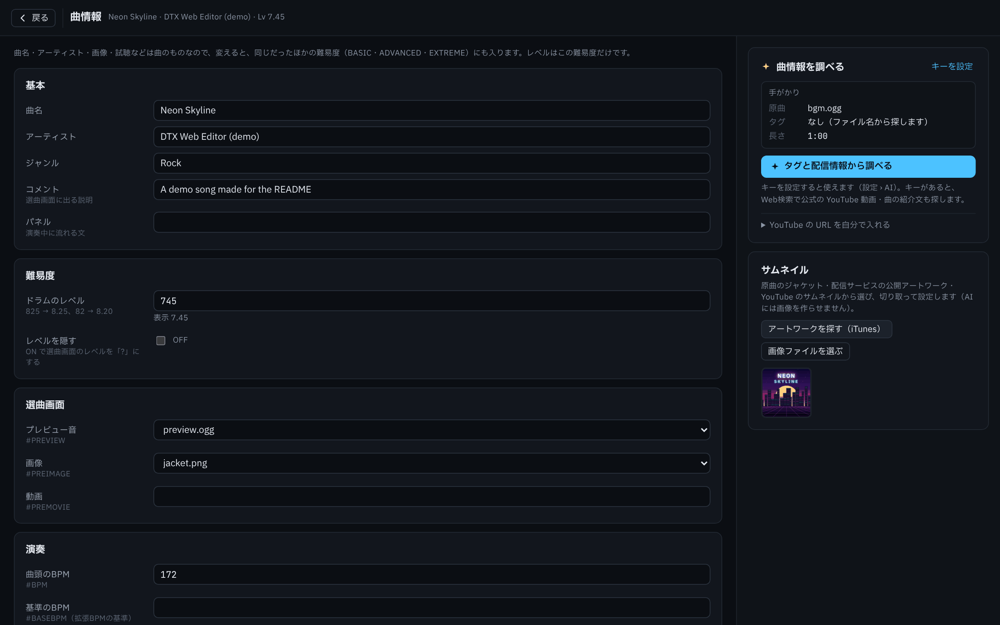</p>
</details>

## NX へ保存

<p align="center"></p>

- DTX は Shift_JIS・CRLF で書きます（NX がそのまま読める形）。難易度の一覧（set.def）も作ります。
- 使った音だけを曲フォルダに書き出します。NX で読めない文字のファイル名は読める名前に直し、選曲画面の試聴が空なら原曲を入れます。
- Chrome・Edge は曲フォルダへじかに保存します。ほかのブラウザ・iPad・iPhone は ZIP やダウンロードで。
- エディタが使わない行（#RANDOM・BGA・ギターやベースのチップなど）も、そのまま残します。DTXCreator で作った譜面も開けます。
- 曲は音ごとブラウザの中にも自動で保存されるので、リロードしても「最近の曲」から続きを開けます。Google Drive にも保存して、ほかの端末で続きを開けます（いまは試験中で、使える人を限っています）。
- PC の Chrome・Edge では、DTXMania のフォルダ（DTXManiaNX.exe のある所か DTXFiles）を覚えると、ゲームに入っている曲を、画像・難易度・レベルの一覧から開いて直せます。曲名のフォルダが二重になった曲も読み、set.def が無い・ファイルが足りないなど NX で困る所も点検します。新しい曲は BOX を選んでその中に保存できます。Google Drive には、保存した曲のフォルダだけを送ります（くわしくは[説明書](docs/manual.md#dtxmania-の曲pc)）。

## iPad・iPhone でも

<p align="center">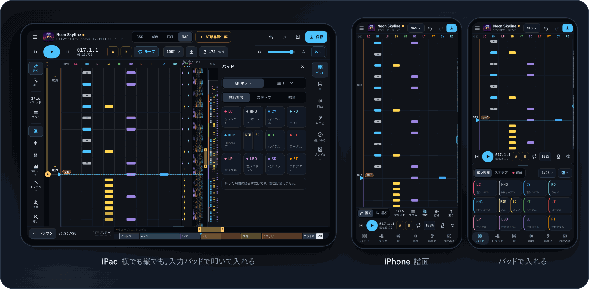</p>

指で使う端末では、自動でタブレット用・スマホ用の画面になります（設定の「タッチ操作」で切り替えも）。縦でも横でも使えます。

| したいこと | PC | iPad | iPhone |
| --- | --- | --- | --- |
| 置く | クリック | タップ | 指の上の吹き出しで確かめて離す |
| 消す | ダブルクリック | ダブルタップ | ダブルタップ |
| メニュー | 右クリック | 長押し | 長押し（下から出る） |
| スクロール・拡大 | ホイール・<kbd>Ctrl</kbd>+ホイール | なぞる（はじくと慣性）・ピンチ | なぞる・ピンチ |
| 元に戻す・やり直す | <kbd>Ctrl</kbd>+<kbd>Z</kbd>・<kbd>Ctrl</kbd>+<kbd>Y</kbd> | 2 本指タップ・3 本指タップ | 2 本指タップ・3 本指タップ |
| 叩いて入れる | キーボード・電子ドラム | 入力パッド（試し打ち・ステップ・録音） | パッドのタブ |

iPad・iPhone では、フォルダを選ぶこと・電子ドラム（Web MIDI）・YouTube の自動合わせは使えません。曲は ZIP で開いて ZIP で持ち出します（ブラウザの中にも自動で保存されます）。iPhone ではステム分解も使わないので、PC や iPad で分けた曲を持ってきてください。

<details>
<summary><b>指の操作の決まり（タブレット版・スマホ版を作ったときの設計図）</b></summary>
<p align="center">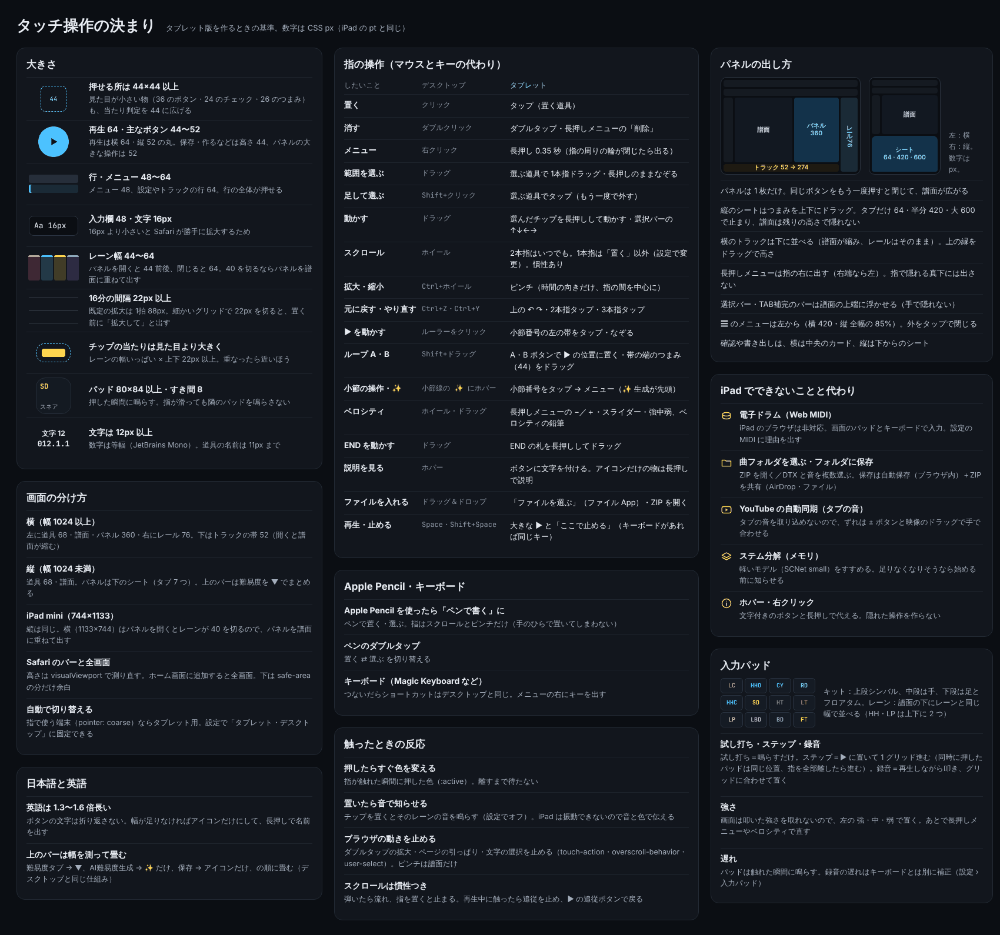</p>
<p align="center">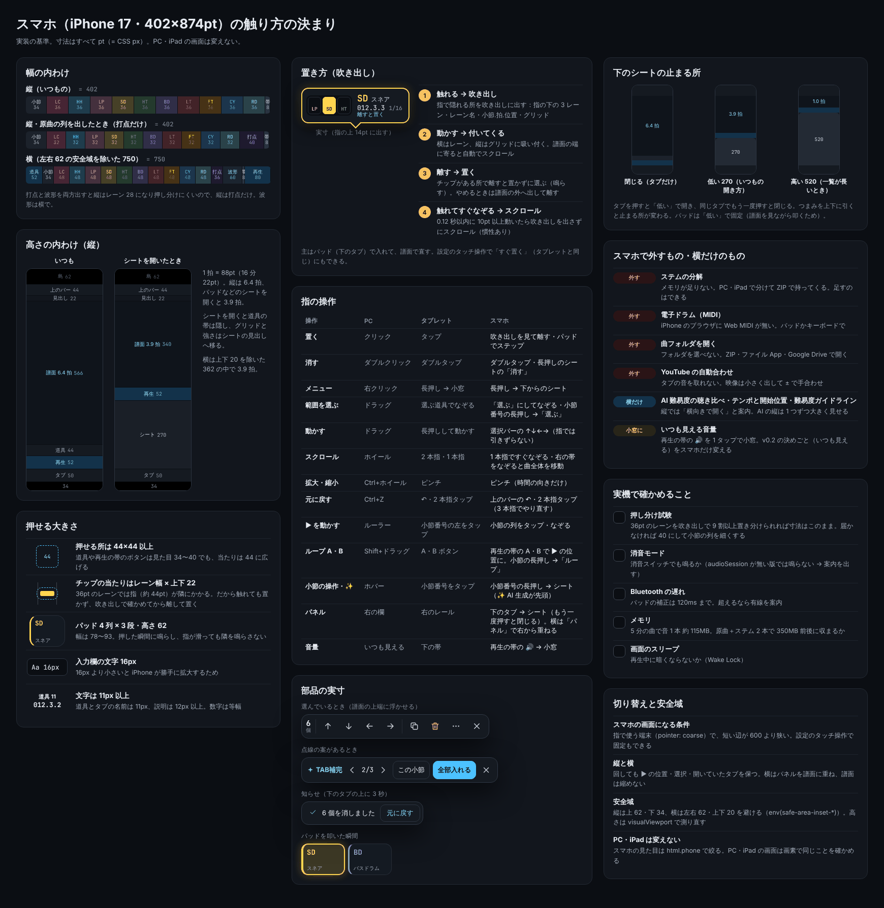</p>
</details>

## アプリとして使う

- **iPad・iPhone**　Safari の共有ボタン › 「ホーム画面に追加」。バーの無い全画面のアプリになります。
- **PC**　Chrome・Edge のアドレスバーの「インストール」で、専用の窓のアプリに。
- 一度開けば、ネットが無くても開けます（AI・曲情報の検索・YouTube はネットが要ります）。新しい版は、開いたときに自動で入ります。

## よくある質問

<details>
<summary><b>無料ですか？ 曲のデータはどこに送られますか？</b></summary>

無料です。曲・譜面・音は、ブラウザの中と、あなたが選んだフォルダ（と Google Drive）だけで扱います。このサイトのサーバーには何も送りません。AI を使ったときだけ、譜面の特徴や打点の数値を OpenRouter に送ります（音は送りません）。

</details>

<details>
<summary><b>どのブラウザで使えばいいですか？</b></summary>

PC は Chrome か Edge がおすすめです。曲フォルダへのじかの保存、電子ドラム、GPU でのステム分解、YouTube の自動合わせは Chrome・Edge だけです。iPad・iPhone は Safari で使えます。

</details>

<details>
<summary><b>AI のキーがないと使えませんか？</b></summary>

使えます。耳コピのアシスト、TAB補完、小節の生成（写す・採譜）、AI難易度生成（ルールだけで作る）はキーなしで動きます。キーを入れると、AI の案、曲情報の検索、レベルの判定が増えます。

</details>

<details>
<summary><b>作った譜面が NX で読めない・音が鳴らない</b></summary>

保存した曲フォルダを、そのまま DTXManiaNX の曲のフォルダ（DTXFiles など）に置いてください。保存は Shift_JIS で、Shift_JIS で書けない文字（♡・絵文字など）のファイル名は保存のときに直します。それでも読めないときは、譜面と曲フォルダを添えて Issue で教えてください。

</details>

## もっと詳しく

- [説明書（すべての機能）](docs/manual.md) … 置き方・耳コピ・強さ・ステム・キット・AI・iPad・iPhone の細かい説明
- [耳コピの精度の測り方と結果](docs/bench.md)
- [Safari・iPad のメモ](docs/safari.md)
- [Google Drive への保存のしくみ](docs/drive.md)

## クレジット

- **ドラムの採譜**　[ADTOF](https://github.com/MZehren/ADTOF)（M. Zehren, M. Alunno, P. Bientinesi）を ONNX にしたモデル（[thebluescreen/adtof-drums-onnx](https://huggingface.co/thebluescreen/adtof-drums-onnx)、CC BY-NC-SA 4.0）。非商用に限るライセンスなので、商用で使うときは採譜を切ってください。
- **ステム分解**　[unblend](https://github.com/Ryan5453/unblend)（R. Fahey）がブラウザ用にしたモデル。重みに利用条件の明示が無いので、非商用の個人利用で使ってください。
- **標準キットの音**　GeneralUser GS（S. Christian Collins）と、CC0 の音源（Karoryfer Samples・FreePats・Sonic Pi など）。出どころは [public/kits/CREDITS.txt](public/kits/CREDITS.txt)。
- **デモ曲**　README の画面に出てくる「Neon Skyline」とそのジャケットは、この README のために作ったものです（実在の曲ではありません）。

## 開発者向け

React・TypeScript・Vite で作っています。

```sh
npm install
npm run dev      # 開発サーバー（http://localhost:5173/dtx-mania-web-editor/）
npm test         # テスト（Safari で動かなくなる書き方の見張りも）
npm run build    # 型チェックとビルド
npm run deploy   # テストとビルドを通して gh-pages に公開
```

フォルダの構成と作りのメモは [説明書の「開発」](docs/manual.md#開発)、作業の決まりは [CLAUDE.md](CLAUDE.md) にあります。README の図と画面写真は `scripts/readme/`、アプリのアイコンは `scripts/icon-art.mjs` と `scripts/make-pwa-images.mjs` で作り直せます。

ライセンスは [MIT](LICENSE) です（標準キットの音とモデルは、それぞれのライセンスに従います）。
